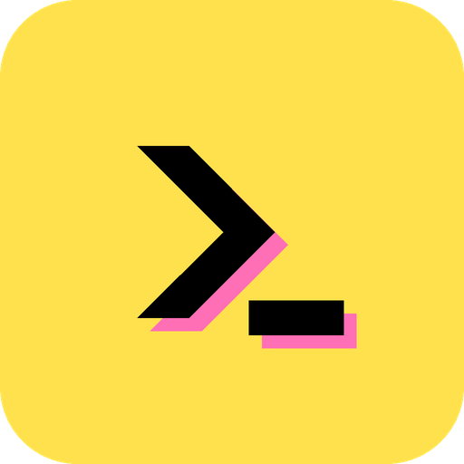
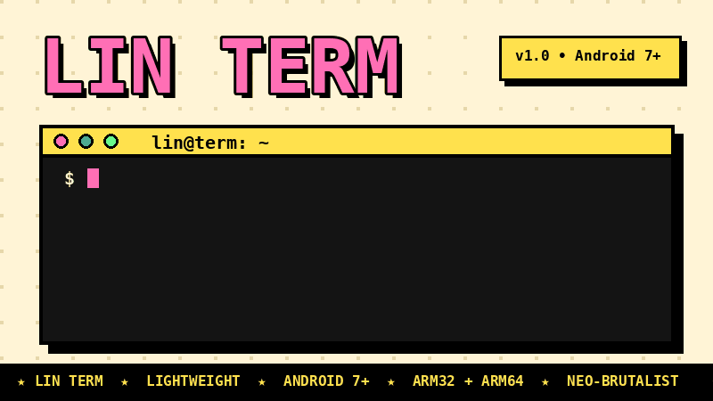

# Lin Term

**A lightweight terminal for Android with a bold, neo-brutalist identity.**

---

## About

Lin Term is a full Linux-style terminal environment that runs natively on Android, with no root
required. It is built on the mature [Termux](https://github.com/termux/termux-app) core and
reshaped around two goals: a **smaller footprint** and a **distinctive interface** that stays out
of the way and is easy to read at a glance.

## Highlights

**Lightweight**
Minimal preinstalled packages and per-architecture APKs keep downloads small. Everything else
is one `pkg install` away.

**Distinctive design**
A neo-brutalist visual language: thick outlines, hard offset shadows, flat high-contrast colors,
and monospace typography throughout the app chrome. Light and dark variants are both supported.

**Broad device reach**
Runs on Android 7.0 and newer, on both 32-bit and 64-bit ARM devices.

**Responsive by design**
Layouts are density-independent and adapt to compact phones, tall displays, tablets, and
landscape orientation.

**Trustworthy releases**
Every release is built in CI, signed, and published with SHA-256 checksums.

## Design language

| Element | Treatment |
|---------|-----------|
| Borders | 3–4 dp solid black |
| Shadows | Hard offset, no blur |
| Palette | Cream `#FFF4D6` · Yellow `#FFE14D` · Pink `#FF6FB5` · Blue `#4D9DFF` · Ink `#000000` |
| Typography | Bold monospace |
| Corners | Square |

A matching terminal color scheme ships in [`config/colors.properties`](config/colors.properties).

## Compatibility

| | Support |
|---|---|
| Android | 7.0 (API 24) and newer |
| Architectures | `arm64-v8a` (64-bit) · `armeabi-v7a` (32-bit) |
| Distribution | Signed APKs via [GitHub Releases](https://github.com/USERNAME/lin-term/releases/latest) |

Lin Term uses the `com.termux` application ID, so it replaces rather than coexists with Termux.

## Under the hood

- **Terminal core:** Termux terminal emulator and view libraries
- **Package ecosystem:** Termux `apt`-based bootstrap (`apt-android-7`)
- **Build:** Gradle, NDK, GitHub Actions
- **Targeting:** `minSdk 24` · `targetSdk 28`

## Roadmap

- [ ] Custom lean bootstrap with a reduced default package set
- [ ] Neo-brutalist Settings and dialog screens
- [ ] F-Droid metadata

## Documentation

- [Building & Releasing](docs/BUILDING.md)
- [Lean bootstrap](docs/BOOTSTRAP.md)

## Contributing

Issues and pull requests are welcome. For larger changes, please open an issue first to discuss
the direction.

## Credits & License

Lin Term is built on [Termux](https://github.com/termux/termux-app) and released under the
**GNU GPL v3**. See [`NOTICE.md`](NOTICE.md) and `LICENSE.md`. Lin Term is an independent project
and is not affiliated with the Termux developers.
